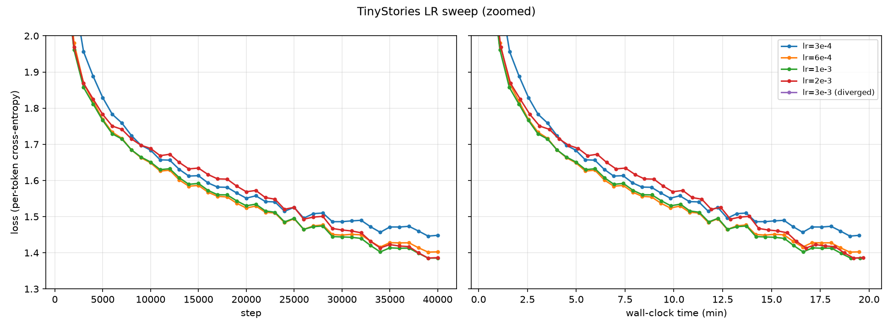
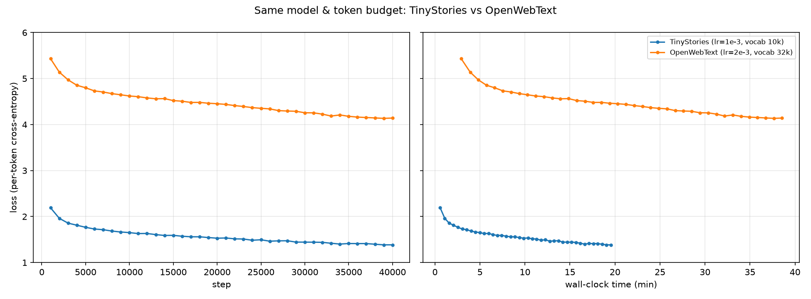
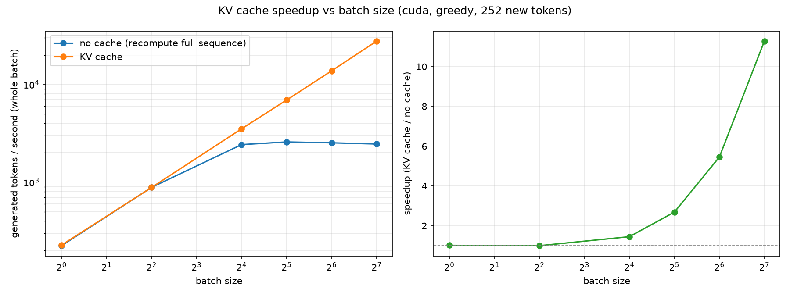
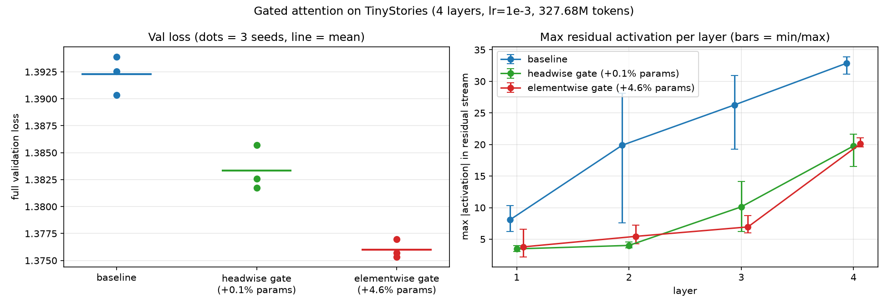

# 从零实现 Transformer 语言模型：训练、推理优化与 Gated Attention 复现

基于 [Stanford CS336（Spring 2025）Assignment 1](https://github.com/stanford-cs336/assignment1-basics)，不使用 `nn.Linear`、`nn.Embedding`、
`F.softmax`、`torch.optim.AdamW` 等现成实现（只用 `nn.Module` / `nn.Parameter` 和基本张量运算），从零实现了 BPE 分词器、decoder-only Transformer、AdamW 和完整的训练/推理流程，在单张 NVIDIA L40 上完成训练，
并在此基础上做了三项扩展：**训练加速**、**KV cache 推理优化**，以及复现 NeurIPS 2025 最佳论文 **Gated Attention** 的小规模对照实验。

## 主要结果

| | 结果 |
|---|---|
| TinyStories（2270 万参数，3.28 亿 token） | 完整验证集 loss **1.394**（课程目标 ≤ 1.45），单卡约 20 分钟 |
| OpenWebText（同结构，词表 32K） | 完整验证集 loss **4.131**（1.365 bits/byte） |
| 训练加速 | bf16 autocast + `torch.compile`：**3.07×**（9.5 万 → 29.2 万 tok/s） |
| KV cache | 批量生成时加速比随 batch 增大，batch 128 时 **11.3×**（2,461 → 27,751 tok/s）；batch 1 时受 kernel 启动开销限制，几乎不加速（有 profiler 分析） |
| Gated Attention | 3 个随机种子下 val loss **1.3923 → 1.3760**（elementwise）；只增加 0.1% 参数的 headwise 门控也降到 1.3833；残差流最大激活降到约 40% |

## 实现了什么

全部模型与训练组件都按 handout 从零手动实现，并通过课程提供的测试（`uv run pytest`：52 passed, 2 skipped）。

- **BPE 分词器**（`train_bpe_v1.py`、`tokenizer.py`）：GPT-2 风格的正则预分词；按特殊 token 切分文件后**多进程**预分词；
  合并时**增量更新** pair 计数（只更新受影响的词，而不是每轮全部重算）；编码时缓存已经处理过的词。
  TinyStories（10K 词表）训练约 45 秒；OpenWebText（32K 词表，11.9 GB 文本）用 32 个进程约 3.3 小时。
- **模型**（`modules.py`）：Linear、Embedding、RMSNorm、SwiGLU、RoPE、数值稳定的 softmax、带因果掩码的多头自注意力、
  pre-norm Transformer block、Transformer 语言模型；attention 支持 **KV cache** 和可选的**门控**（`--attn_gate`）。
- **训练**（`optimizer.py`、`utils.py`、`train.py`）：AdamW、warmup + 余弦学习率调度、全局梯度裁剪、交叉熵、
  基于 `np.memmap` 的数据采样、checkpoint 保存与恢复；训练脚本支持 TF32 / bf16 autocast / `torch.compile` 开关、
  吞吐统计（排除评估时间）、loss 变成 NaN/inf 时自动停止。
- **生成**（`decoding.py`）：temperature 和 top-p 采样，可选 KV cache（先 prefill 整段 prompt，之后每步只算 1 个新 token）。
- **实验与分析工具**：完整验证集评估（`eval_full.py`）、训练吞吐测速（`bench_throughput.py`）、生成测速（`bench_decode*.py`）、
  attention sink / 激活值分析（`analyze_attention.py`）、学习曲线绘图（`plot.py`）、学习率扫描脚本（`scripts/lr_sweep.sh`）。

## 实验

所有实验的模型结构相同：4 层、d_model 512、16 头、d_ff 1344、context 256；AdamW（β = 0.9 / 0.95，weight decay 0.1），
warmup 200 步，余弦衰减到最大学习率的 1/10；batch 32 × 40,000 步 = 3.28 亿 token。
最终 loss 一律在**完整验证集**上评估：训练中只抽样一部分验证集，和完整验证集相差可达 ±0.01。

### 1. 训练加速

单张 L40，batch 32 × 256，每种配置 3 轮交错运行取中位数（各轮波动 < 1.5%）。详见 [`results/throughput_l40.md`](results/throughput_l40.md)。

| 配置 | tok/s | 相对 FP32 |
|---|---|---|
| FP32 | 95,182 | 1.00× |
| + TF32 | 112,375 | 1.18× |
| BF16 autocast | 136,429 | 1.43× |
| **BF16 + `torch.compile`** | **292,323** | **3.07×** |
| BF16 + compile + TF32 | 290,895 | 3.06× |

- TF32 只快 18%：L40 上 TF32 Tensor Core 的峰值和普通 FP32 一样（约 90 TFLOPS），和按硬件参数做的预测一致；
  开了 BF16 之后再开 TF32 没有任何作用，因为矩阵乘法已经都是 BF16。
- `torch.compile` 在 BF16 之上再快 2.14×：这个小模型里，手写的 RMSNorm、RoPE、softmax、SwiGLU 等逐元素运算受显存带宽限制，
  编译后被融合成少数几个 kernel。
- **踩过的坑**：compile + BF16 一开始会让反向传播出现 NaN。用对照实验（eager / `aot_eager` / inductor 后端、逐个替换模块）定位到：
  自己写的 softmax 里用于数值稳定的 `max` 参与了求导。改成 `.detach()` 后问题消失；这在数学上完全等价，因为 softmax 对平移不变。

### 2. TinyStories：学习率扫描



| 最大学习率 | 3e-4 | 6e-4 | **1e-3** | 2e-3 | 3e-3 |
|---|---|---|---|---|---|
| 完整验证集 loss | 1.4567 | 1.4111 | **1.3939** | 1.3952 | 约第 400 步发散 |

最佳学习率（1e-3～2e-3）就在发散点（3e-3）下方。lr = 3e-3 的实验发散后先停在 ln(10000) ≈ 9.21（相当于在词表里均匀随机猜），
一万多步后才变成 NaN：发散不一定马上表现为 NaN。详见 [`results/lr_sweep.md`](results/lr_sweep.md)。

作为对照，同样的代码在 Apple Silicon（MPS）上训练 4000 万 token，完整验证集 loss 为 1.672（课程的低资源目标是 ≤ 2.00）。

### 3. OpenWebText

| 最大学习率 | 6e-4 | 1e-3 | **2e-3** |
|---|---|---|---|
| 完整验证集 loss | 4.1823 | 4.1443 | **4.1306** |



两个数据集的“每 token loss”不能直接比（词表不同，一个 token 对应的字节数也不同），换算成 bits/byte 后：
TinyStories 0.488，OpenWebText 1.365。OWT 的文本多样性高得多，同样的模型和训练量远远不够，生成的文本句式像新闻，
但内容空洞、重复。另外，OWT 训练集有 5.4 GB，用 mmap 随机读时一开始被共享磁盘的随机读速度卡住（GPU 利用率只有 23%），
预热页缓存后恢复到 98%。详见 [`results/owt_baseline.md`](results/owt_baseline.md)。

### 4. KV cache

带缓存和不带缓存的生成结果逐 token 一致（`tests/test_kv_cache.py`）。

| batch | 1 | 4 | 16 | 32 | 64 | 128 |
|---|---|---|---|---|---|---|
| 不用缓存（tok/s） | 224 | 885 | 2,426 | 2,581 | 2,529 | 2,461 |
| 用 KV cache（tok/s） | 228 | 884 | 3,519 | 6,928 | 13,787 | **27,751** |
| 加速比 | 1.02× | 1.00× | 1.45× | 2.68× | 5.45× | **11.28×** |



- **batch 1 时几乎不加速**：用 profiler 看一次单 token 前向，一共启动了 253 个 CUDA kernel，GPU 实际计算只有 0.48 ms，
  其余约 90% 的时间花在 Python 执行和 kernel 启动上。输入 1 个 token 和 256 个 token，一步都要约 4.3 ms，KV cache 省下的计算本来就很少。
- **batch 增大后**：不用缓存时，从 batch 16 起吞吐就停在约 2,500 tok/s（每步都要重算整段，变成计算瓶颈）；
  用缓存时吞吐几乎和 batch 成正比。这验证了 KV cache 省下的是计算，只有计算成为瓶颈时才有明显收益。
- 详见 [`results/kv_cache_l40.md`](results/kv_cache_l40.md) 和 [`results/kv_cache_batch_l40.md`](results/kv_cache_batch_l40.md)。

### 5. Gated Attention 复现

复现 Qiu et al., [*Gated Attention for Large Language Models: Non-linearity, Sparsity, and Attention-Sink-Free*](https://arxiv.org/abs/2505.06708)
（NeurIPS 2025 最佳论文）中效果最好的形式：在 attention 输出之后、输出投影之前，乘一个由该层输入算出的 sigmoid 门控。



| TinyStories，lr = 1e-3 | seed 0 | seed 1 | seed 2 | 均值 ± 标准差 | 参数量 |
|---|---|---|---|---|---|
| baseline | 1.3939 | 1.3903 | 1.3926 | 1.3923 ± 0.0018 | 22.70M |
| headwise 门控 | 1.3817 | 1.3826 | 1.3857 | 1.3833 ± 0.0021 | 22.73M（+0.1%） |
| **elementwise 门控** | **1.3753** | **1.3770** | **1.3757** | **1.3760 ± 0.0009** | 23.75M（+4.6%） |

- **val loss**：elementwise 门控平均降低 0.0163，3 个种子全部更好、范围不重叠（差距约为种子间标准差的 9 倍以上）。
  headwise 门控只多 0.1% 参数，也降低了 0.0090，说明收益主要来自门控机制本身，而不是参数变多。
- **massive activation**：门控把残差流里的最大激活值从平均 21.8 降到约 9（约 40%），前 3 层降到 1/4～1/3，和论文结论一致。
  不过我们的小模型里离群值只有典型值的 25～35 倍，远没有大模型里那么极端。
- **没有复现的部分**：
  - 训练稳定性：lr = 3e-3 时门控版和 baseline 一样在约第 400 步发散。论文的稳定性收益出现在更深的模型、更大的 batch 下，
    而这里是学习率本身超出了稳定范围。
  - attention sink：4 层的 baseline 本来就没有 sink（分给第一个 token 的注意力约 1.1%，低于均匀分布时的约 2.4%），所以无法检验。
    论文里的 sink 从 baseline 的第 6 层才开始出现。

详见 [`results/gate_study.md`](results/gate_study.md)。

## 复现

环境用 [uv](https://github.com/astral-sh/uv) 管理。macOS 上会安装 MPS 版 torch；Linux 上 `pyproject.toml` 指定从 PyTorch 的 cu128 源安装（适配 CUDA 12 驱动）。

```bash
uv sync
uv run pytest                       # 课程测试 + KV cache 测试
```

数据（按课程说明下载 TinyStories 和 OpenWebText 样本到 `data/`）：

```bash
uv run python -m cs336_basics.train_bpe_tinystories       # 训练 BPE，保存到 data/tokenizers/
uv run python -m cs336_basics.encode_dataset --dataset tinystories --split train   # 编码成 uint16 数组
uv run python -m cs336_basics.encode_dataset --dataset tinystories --split valid
```

训练、评估与分析：

```bash
# 训练（单卡 L40 约 20 分钟）；ATTN_GATE=elementwise/headwise 开启门控，SEED 指定随机种子，DATASET=owt 切换数据集
CUDA_VISIBLE_DEVICES=0 sh scripts/lr_sweep.sh 1e-3

uv run python -m cs336_basics.eval_full runs/ts_gpu_lr1e-3                    # 完整验证集评估
uv run python -m cs336_basics.plot runs/ts_gpu_lr1e-3 --train --out figures/curve.png
uv run python -m cs336_basics.decoding --run_dir runs/ts_gpu_lr1e-3 --kv_cache  # 生成文本
uv run python -m cs336_basics.analyze_attention runs/ts_gpu_lr1e-3 --device cpu
```

## 目录结构

```
cs336_basics/
  modules.py            模型组件、KV cache、attention 门控
  train_bpe_v1.py       BPE 训练（多进程预分词 + 增量合并）
  tokenizer.py          编码 / 解码
  optimizer.py          AdamW、学习率调度
  utils.py              交叉熵、梯度裁剪、数据采样、checkpoint
  train.py              训练循环
  decoding.py           文本生成
  eval_full.py  plot.py  bench_*.py  analyze_attention.py   评估、绘图、测速、分析工具
scripts/lr_sweep.sh     实验脚本
tests/                  课程测试 + KV cache 测试
results/  figures/      全部实验结果和图
```

## 局限

- 所有实验只在一个模型规模（4 层，约 2300 万参数）上进行；Gated Attention 的结论也只在 TinyStories 上验证。
- elementwise 门控多了 4.6% 参数，没有像论文那样相应减小 FFN 宽度来对齐；headwise 实验排除了主要部分，但两者之间的差距仍可能部分来自参数量。
- 分词器编码较慢（没有按 merge 优先级做优化），把 OpenWebText 训练集编码成 27 亿 token 用了约 15 小时。

## 致谢

课程框架、测试与 handout 来自 [Stanford CS336](https://stanford-cs336.github.io/spring2025/)（MIT License，见 `LICENSE`）；
`pretokenization_example.py` 由课程提供。Gated Attention 的方法来自 Qiu et al.（2025）。
